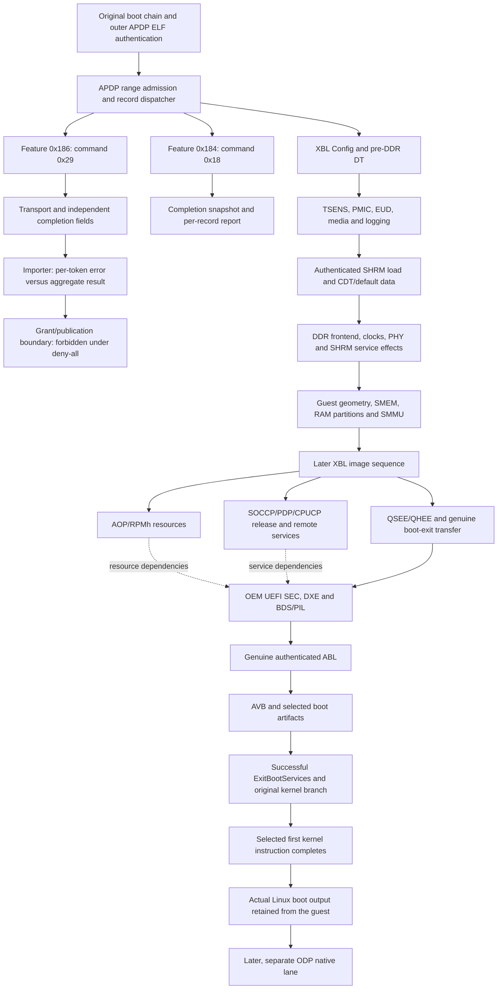

# Boot dependency work map

## Status and authority

This document maps current work. It does not report a completed boot.

Evidence labels:

- **Static:** selected firmware bytes, decoded instructions, or image tables.
- **Native:** an observation from a retained virtual-platform execution artifact.
- **Model:** implemented repository behavior. Implementation alone does not prove firmware execution.
- **Inference:** a dependency that still needs selected-image or execution evidence.

The removed vendor references supplied no meaningful implementation information.
Prior evidence pages, accumulated research, and device probes supply the technical basis.
A manufacturer or family catalog pattern can guide a model when the record states the pattern, its basis, and its limit.
A pattern from one family is not proof for another target.

Preserve the genuine OEM path: ROM and XBL, then UEFI, ABL, and the selected kernel.
Keep image authentication, debug authorization, and ROM-patch authorization separate.
Do not manufacture crypto success, weaken secure boot, or replace a firmware transition with a host-assigned PC.
The older plan's always-good-authentication passages do not authorize a bypass.
Platform composition and normal runs do not require a physical device.
Authorized hardware research follows the separate [evidence procedure](oplus/infiniti/hardware-evidence.md).

## Current verified checkpoint

**Native:** SM8850 run921 verifies kernel entry and debugger detach, then captures 4,573 kernel UART bytes.
The verifier steps the first kernel instruction at `0xc7800000` in nonsecure EL1.
The genuine OEM kernel reaches early-console output and interrupt initialization.
The next unsupported access reads the timer at `0x17810008`.
The [execution evidence](oplus/bringup.md#status) records the retained files and limits.
SM8845 does not reach kernel entry in the recorded runs.
A recent SM8845 run stops in CPUCP with failure `0x183800f4` at PC `0x1d8066f0`.
That is a bounded observation, not a missing universal milestone.
Kernel handoff is not a qualification requirement for SM8845.

## Earlier checkpoints

SM8850 run129 completes DDR exit, both SMMUs, SMEM construction, DDR publication, and RAM partition updates.
Original TME code accepts the LLCC state, initializes PIMEM, completes SHRM protection, and returns success.
Run128 records five successful QUP programming calls and Boolean one from the original initialization function.
Run129 records zero from DCP preparation, DCP release, and TLMM initialization.
Run131 records zero from all ten MGPI calls, global enable, all nine VIOCTL calls, and the complete SPMI configuration function.
Run136 records zero from the lock helper and complete PMIC pre-AOP function.
It loads AOP Config, then starts AOP loading.
Run142 completes AOP, TZ_AC_CFG, SOCCP_DTB, and SOCCP loading.
It reaches SOCCP_DEBUG and the separate image-policy initializer.
Run146 executes the first digest query, then reads missing import `0x4169d0` at TME PC `0x43cae4`.
Run148 records the getter's original `0x4006` result for an absent digest record.
Run151 passes both guarded dump-policy queries and completes SOCCP_DEBUG, SOCCP_DCD, PDP_CDB, PDP, CPUCP_DTB, and CPUCPFW.
It also completes TZ_QTI_Config, QSEE Dev Config, and QSEE loading.
Its final fault is an eight-byte SMMU read at `0x150ed070`, from APSS PC `0x14862718`.
The SPMI abort occurs later, during simulator shutdown. It is not the initiating failure.
Run156 passes the corrected SMMU format check, loads QHEE and APPSBL, and reports `SBL1, End`.
Its next fault reads XPU offset `0x20c` at system address `0x0152020c`, from PC `0x14859f80`.

Run159 passes the reporting-control sequence with eight APSS CPUs configured.
It next reads missing TME import `0x417238` at PC `0x432f7a`.
Run161 completes imported SMEM finalization through the original range and permission services.
Its next initialization function reads missing import `0x416b14` at TME PC `0x42a51e`.

SM8845 run110 records zero from both dedicated PIMEM allocations and their caller.
It loads QUPFW and DCP, then reaches TLMM and the later SPMI configuration.
Run113 records zero from its lock helper and complete PMIC pre-AOP function.
It loads AOP Config and reports AOP authentication metadata timing.
Run114 checks 112 loaded AOP bytes through both IMEM views and executes the formerly rejected read.
Run117 completes AOP, TZ_AC_CFG, SOCCP_DTB, and SOCCP loading.
Its first diagnostics report protection allocation failure for controller `0x00d00000` and range `0x00d24000+0x3000`.
Run120 records exhaustion of the original allocator's assigned cohort `[3,5)`.
The subsequent GPT-open error belongs to crash logging.
Runs118 and119 identify `xbl_sc_logs` and five occupied native coldplug handles.
The GPT contains that partition. The original allocator has no sixth handle.
The later write rejection at `0x17960020` also belongs to fatal cleanup.
Run121 identifies an unowned APSS policy duplicated during its transfer to TME.
The duplicate retains domain-four permissions after the last owner releases the region.
The functional correction transfers that policy instead of duplicating it.
Run122 passes this allocation and reaches missing import `0x4169d0` at TME PC `0x43cd60`.
Run123 passes the guarded queries and completes SOCCP_DEBUG, SOCCP_DCD, PDP_CDB, PDP, and CPUCP_DTB.
It reports CPUCPFW authentication metadata timing.
Its next fault is a one-byte TME read at `0x21835500`, from PC `0x230bbc`.
Run124 passes that read through the shared CPUCP SRAM alias and completes CPUCPFW, TZ_QTI_Config, QSEE Dev Config, and QSEE loading.
The corrected SMMU diagnostics report no context fault.
The original error handler reports error code 72 at `sbl1_mc.c:2450`.
Its later cleanup writes `0x17960020`, which the current CPUCP mailbox rejects.
The subsequent SPMI abort occurs during simulator shutdown, not before the original error.
Run125 passes the corrected SMMU format check, loads QHEE and APPSBL, and reports `SBL1, End`.
Its next fault reads the same XPU word, from PC `0x148584b4`.
Run126 passes the reporting-control sequence and reaches the same missing TME import at PC `0x432fd2`.
Run128 completes the same SMEM finalization and reaches import `0x416b14` at TME PC `0x42a566`.
Those earlier runs reach neither UEFI nor ABL nor the kernel.

Model checks and intermediate callback completion do not establish kernel execution.

**Native:** both OEMs complete the original authorization-report handler with unchanged denial records and output length `0xc8`.
The handler returns zero without creating a grant.
SM8850 still denies commands `0x29` and `0x18`.
SM8845 denies command `0x29`, matching its single APDP record.

Both original NCC gasket polls observe value six and complete.
SM8850 run47 and SM8845 run44 pass the expanded SPMI timing, pad, and clock group.
Both pass the original `DP_Milestone` protection transition and complete `sbl1_xblconfig_init`.
Namespace acquisition retains each authority's policy without exposing foreign retained permissions through configuration readback.
Both pass the former TME permission and exact-range failures.

Both OEMs complete `boot_pre_ddr_dtb_load`, `tsens_init_if`, and `boot_check_device_temp`.
The timer's second view shares the physical frame's counter, access controls, and interrupt state.
The thermal group preserves calibration, delayed conversion, guest temperature policy, and an explicit normal-progress watchdog substitute.

SM8850 completes the original IBUS initialization with an explicitly disconnected alert producer.
SM8845 completes its display phase request through the existing sparse PMIC storage.
Both complete device initialization, peripheral discovery, and `sbl1_pmic_init`.
The original driver logs report 1332 and 724 SPMI transactions respectively.
Both complete `EUD Post PMIC Init` and enter the UFS path.
SM8850 run55 and SM8845 run49 also complete device readiness and read the UFS configuration descriptor.
SM8850 run59 and SM8845 run54 complete `media_init:3`, the watchdog check, and storage logging initialization.
SM8845 run51 also proves that the guest creates its log header and writes its boot log to LUN four.
Both OEMs pass the cold DDR status checks and complete SHRM image loading.
SM8850 run61 and SM8845 run57 also pass the selected calibration reads.
SM8845 uses virtual revision 1.0 because its original CPR table rejects revision 2.0.
SM8850 run68 and SM8845 run67 pass CPR initialization, Railway overrides, and the pre-DDR hardware callback.
Both complete the forced-download check, training-data load, pre-DDR clocks, and DDR parameter setup.
Both pass the DDR regulator requests and report `DDR_INIT with shrm.elf`.
Both then report enabled PXI read and write training.
SM8850 run87 and SM8845 run84 return from the original `DDR_FW_Init`.
Both complete `sbl1_ddr_init` and report 4096 MB on rank zero.
The guest clock plan retains its valid enabled idle row.
SM8850 run95 and SM8845 run90 execute key derivation, HMAC, and key cleanup during `do_ddr_training`.
Both take the guest's HMAC-success branch and report `DDR: Start of DDR Training Init`.
SM8850 run99 and SM8845 run92 complete analog calibration and five subsequent measurement rounds in all four MC banks.
SM8850 now connects all six PLL sources from the selected training table.
Both then reject a SHRM trigger write at `0x31076064`.
SM8850 also passes the former TME SRAM copy fault at `0x0f08d000`.
SM8845 run69 exposed premature reset ownership from an XBL scratch-marker write.
An XBL scratch marker must not acquire reset ownership.
The regression and later native runs pass that boundary.
The cause of earlier reset stalls in runs58 and63 remains unproven.
SM8850 run56 previously failed an RCGR update poll before UART initialization.
Its null-pointer fault occurred in the secondary fatal logger.
Later runs pass that path without diagnostic breakpoints, but the initiating timing cause remains unresolved.

The cold profile now holds APSS until the original CPUCP core-release store.
Initially unpowered lanes own their core reset state before domain initialization.
The held APSS adds no running quantum keeper or software permission to execute.
The original reset callback starts time synchronization before the wrapper releases the CPU.
Run146 records CPUCP `0x33529a` before APSS `0x300000`.
Its `cold-reset-order.json` retains both register snapshots.

Run140 previously timed out during concurrent APSS and CPUCP PLL setup.
Both ROM paths can program shared GPLL0 and GPLL4.
Their exact failing interleaving remains unproved.
The explicit cold ordering removes that overlap without changing PLL status or guest writes.

SM8845 retains its original PBS CRC mismatch diagnostics.
The model preserves uploaded bytes but supplies no autonomous PBS execution result.
The original firmware continues after these diagnostics. This is not a fabricated CRC success.

The post-DDR map now covers auxiliary images, DCP, SOCCP, PDP, CPUCP, QSEE/QHEE, UEFI, and ABL.
Shared memory retains guest-loaded data and exact physical/local aliases.
A native hardware probe checks DCP power/reset transitions, RNG channel aliases, and sixteen independent scratch words.
These checks do not establish native remote-firmware execution.
Genuine guest probes also verify APSS MPAM, PAuth, random instructions, and virtual-timer delivery through GIC INTID 27.
The CPUCP probe executes DDR code and preserves shared aliases across writes from all three producer paths.
The current integration run passes 100 tests and Clippy with warnings denied.

**Model:** both platforms now compose authenticated AOP publication, PDP SCMI services, and their selected remote-control layouts.
Actual-model fixtures exercise publication, service state, shared IRQs, and real CPUCP reset.
Synthetic protocol responses in those fixtures do not establish native image authentication.
Both OEMs load AOP and PDP.
Native service admission and remote firmware execution remain unobserved.
At this checkpoint, neither OEM reaches UEFI, ABL, or the kernel.

SM8850 run165 enters QSEE at EL3 and reaches the AOSS debug configuration word.
SM8845 run132 completes the selected PDC trigger table and reaches hardware mutex one at `0x18860004`.
Static analysis identifies the same mutex protocol in both images at EL3 and secure EL1.
The platform reuses the existing atomic mutex owner rather than a write-echo register.
SM8845 run133 executes `eret` at `0x1468e2dc` and enters QSEE at EL1, PC `0x14694000`.
The bootstrap initializes `SCR_EL3` to `0x30e00`, with nonsecure selection clear, and `SPSR_EL3` to EL1h.
The native trace also records the later EL3 return to `0x157b6b68`.
QSEE receives eight entropy bytes and continues into page-map construction.
This proves QSEE execution, not UEFI or Linux execution.

SM8850 run167 executes the donor channel constructor at `0x22fee4` and returns to OEM PC `0x4352f4`.
The compatibility bridge preserves three independent records despite the different OEM and donor strides.
That run next reaches TME IPCC at `0x05110038`.
The shared IPCC implementation now connects APSS, secure APSS, and TME views with source-aware delivery.
The native fixture exercises real APSS-to-TME and TME-to-APSS interrupts.
These fixture results do not establish completion of the OEM channel sequence.
SM8850 run168 and SM8845 run133 pass the TME IPCC initialization accesses.
Both next read missing legacy import `0xae4`, the interrupt-priority getter.

SM8850 run170 completes these TME accesses and enters QSEE at EL1.
The TME scheduler continues to receive real machine-timer interrupts.
APSS later traps on `dup v0.2d, xzr` at relocated PC `0x4d43bf044`.
The native exception has syndrome `0x1fe00000` and remains at EL1.
The original QSEE instruction is at `0x157bf044`.
The guest's fatal handler loops until the host execution timeout.

The common APSS model now declares `CPACR_EL1.FPEN=1` at architectural reset.
Arm leaves this reset value UNKNOWN, so the model does not claim measured silicon state.
The native fixture verifies EL1 SIMD, the EL0 trap, and guest-controlled permission changes.
SM8850 run172 and SM8845 run136 pass the former SIMD boundary.
Both next write the unmapped configuration word at `0x17600000`.
Their access PCs are `0x5ae1bc808` and `0xe6cbb30a4`.
The SM8850 original writer is `0x157bc808`.
The complete selected QSEE timer cohort already passes native interrupt fixtures.
Kernel entry remains false in both result manifests.

The watchdog group now reuses the existing KPSS engine for both banks.
SM8850 run173 and SM8845 run137 pass the mode write at `0x17600000`.
Both next acquire TCSR hardware lock nine at `0x01f49000`.
The SM8850 writer at `0x157b3d54` claims owner eight and verifies the returned owner.
The platform must preserve that atomic protocol, not return an unconditional grant.
The native SM8850 trace also establishes return from initializer `0x156e571c` and entry into initializer `0x156e5770`.

The complete TCSR bank now reuses 32 independent atomic mutex instances.
SM8850 run174 and SM8845 run138 pass lock nine and next read RPMh DRV0 configuration at `0x1890000c`.
GIC architecture discovery also now agrees with the declared redistributor placement.
The native eight-frame probe failed before this correction and passes afterward.

SM8850 run177 identified a missing admission path for combined authentication opcode `0x10`.
The original handler verifies segments and clears its context before completion.
The observer now captures that context and requires the genuine matching response and consumer release.
It preserves the separate `0x11` and `0x12` path.

SM8850 run179 admits AOP image `0x21` at sequence 41 and publishes the resource database.
The original TME then consumes `cx.lvl` and `mx.lvl` and programs their derived level indices.
Run180 passes those writes and also admits PDP image `0x91` at sequence 55.
It next writes the unmapped RSC interrupt control at `0x00c00218`, from TME PC `0x428524`.

SM8845 run141 identified streaming opcode 7 as the missing segment path.
Its operation 3 verifies the segment hash before it clears the pending bit.
The observer now recognizes this path without treating start, update, or no-op requests as segment completion.
SM8845 run142 admits AOP at sequence 144 and PDP at sequence 238.

SM8850 run181 passes the RSC control access and preserves both admissions.
Both SoCs then stopped at missing legacy import `0x968`, read through address `0x417168`.
Their caller PCs are SM8850 `0x427b4c` and SM8845 `0x427a88`.
The final admission regression passes all nine cases, including the streaming path and its rejection cases.
At that checkpoint, both native result manifests report no kernel entry and no established authentication qualification.

The integrated group supplies PDC configuration, clock/power transitions, GIC fault controls, and the complete immediate fault-monitor inventory.
All 47 host tests and 57 native platform tests passed after correction of the new fixture dependencies.
Clippy passed with warnings denied.
Those checks did not establish native consumption of the later QSEE groups or kernel execution.

SM8850 run184 and SM8845 run145 pass that scheduler query and the paired interrupt-disable and restore calls.
Their TME traces reach WFI at `0x428044` and `0x427f94`, respectively.
They also reach the original retained-state restore vectors at `0x428050` and `0x427fa0`.
The CPU preserves protection and pending state. Real eligible interrupts drive the modeled wake.
The external wake banks remain separate from CLIC under an explicit absent-producer policy.

Run184 next reports an APSS read at `0x174044`, from PC `0x572f51800`.
Run145 next reports an APSS read at `0x1dfa104`, from PC `0xe42caf094`.
Both still report `Kernel entry verified: false`.
Their UART logs prove XBL completion and APPSBL loading, not APPSBL execution.
The next independent groups are the additional QSEE clocks and GPCE startup controls.

The retained-power integration passed 47 host tests and 57 of 58 native tests.
After the new fixture explicitly enabled QBox's PMP implementation, its three retained-power scenarios passed.
The actual timer and CLIC fixtures cover pending-state preservation and masked-source wake exclusion.
See [the retained-power evidence and limits](../../../models/qcom/sm88xx/tme_power_state/evidence.md).

SM8850 run187 and SM8845 run147 pass the additional clock descriptors and GPU policy writes.
The GPCE startup owner preserves the separate XPU aperture and supplies explicit virtual geometry.
It does not complete a key or FIFO operation.
Both runs then report a watchdog bite without kernel entry.
The SM8850 trace waits at source PC `0x15751db4` for DCP status `0x09bab004.bit15`.
The DCP model implements host preparation and release, but not the firmware's idle-state producer.
That producer is the next dependency. A forced status value would not establish its required effect.

The selected SM8850 DCP image contains an embedded RV32 executable and a Zephyr device tree.
The image advertises `rv32imac`, runtime idle, and suspend-to-RAM.
This static evidence identifies a real power-management path, not successful DCP execution.

SM8845 now composes the existing extended UFS and SMMU helpers.
Selected firmware data establishes compatibility without another model or duplicated interrupt table.
The native SMMU fixture proves translation and fault IRQ behavior.
Selected OEM execution still needs the later UFS initialization and UEFI paths.

## QSEE initialization contracts

This map uses SM8850 `RADIO/tz.img`, SHA-256 `afdfaf27b33616718249ac857b7021001f33fe767c74c6e877cd280a3ee99932`.
ELF load segments and AArch64 instructions establish the order and fields below.
SM8850 run172 executes the first group and enters the second group.
A stage marker establishes control flow, not successful completion of every service.
Several callees log or return errors that the enclosing initializer does not check.

### First group: shared producers and software state

Initializer `0x156e571c` calls these functions in order.
It writes stage one to `0x1580f854` before returning.

| Order | Callee | Producer and consumer contract |
| --- | --- | --- |
| 1 | `0x156e63f8` | The guest initializes software flags and pointer `0x1580fb80`. |
| 2 | `0x1574fe80` | XBL supplies SMEM item 137. QSEE validates its versioned identity fields and relative arrays. |
| 3 | `0x1571c448` | Identity and `QUP_INFO`/`IBI_INFO` select configuration. ACTZ governs arena `0x81efd000+0x2000`. |
| 4 | `0x157204d0` | Existing SMEM allocations 469 and 667 receive 128-byte version records at indices one and five. |
| 5 | `0x157571fc` | Descriptor `0x157f8780` initializes the secure IPCC handle and context `0x1580c560`. |
| 6 | `0x15679504` | MPIDR supplies the logical CPU index. Aff2 selects the additional six-core offset. |
| 7 | `0x15757ce0` | Item 137 supplies additional identity fields and an eight-byte-element array. |
| 8 | `0x15681d2c` | QSEE initializes diagnostics at `0x1469a000` and publishes their physical address at `0x14680720`. |
| 9 | `0x15774a2c` | The guest initializes its 128-byte software object at `0x157d9d00`. |
| 10 | `0x156e66e0` | Five identity mappings precede real SMC operation seven. Mapping errors remain effective. |
| 11 | `0x156794cc` | The registration table at `0x157fbcd8` must contain ID five. |
| 12 | `0x1577042c` | `/dev/icbcfg/boot` and `icbcfg_info` supply bounded memory regions. The guest checks alignment and overlap. |
| 13 | `0x1567e5e4` | The existing dump policy at `0x20c02000` selects optional buffer initialization. |

The SMEM consumer requires the publication at `0x01fd4000`, existing heap state, and the shared lock at `0x01f43000`.
The platform must not fabricate missing allocations or replace malformed identity records.
The identity cache begins at `0x15815f1c`.
Fields at source offsets `0x9c..0xa8` select relative arrays for version 14 and later.
Later versions add fields through `0xe8`.

The IPCC descriptor selects protocol zero, local client one, 17 clients, eight signals, and INTID 261.
The existing endpoint at `0x01101000` supplies that contract.
The fixed mappings cover fuse-related regions at `0x221c0000..0x221c9fff` and RNG at `0x010c0000`.
They do not imply reads from every register in those spans.
The ICB group also maps `0x81c60000+0x20000`, which contains the AOP command database.
The existing AOP producer remains responsible for that database.

### Second group: interrupt admission and service state

Initializer `0x156e5770` calls these functions in order.
It writes stage two to `0x1580f854` before returning.

| Order | Callee | Producer and consumer contract |
| --- | --- | --- |
| 1 | `0x157100e0` | The cached I2C revision selects two software fields. This is not a clock-ready query. |
| 2 | `0x1576ffa0` | The guest publishes CPU-domain base `0x19880000` and lane stride `0x01000000`. |
| 3 | `0x15773eb8` | PMU policy, CPU-domain configuration, GIC discovery, and SGI registration precede interrupt admission. |
| 4 | `0x15772fac` | QTimer configuration precedes frequency SMC five and registration of INTIDs 29, 43, and 44. |
| 5 | `0x1567da74` | Watchdog configuration and handler registration require the first group's IPCC handle. |
| 6 | `0x15759128` | The actual firmware function returns without an operation. |
| 7 | `0x1567acf0` | The guest creates nine execution records at `0x157f97e8`, stride `0x1b8`, with their stacks. |
| 8 | `0x157299f4` | The actual firmware function returns zero without an operation. |
| 9 | `0x1567bde4` | The topology table supplies two cluster participation counters. |
| 10 | `0x156793f4` | A real translation publishes object `0x14696a28` at `0x14698fcc`. |
| 11 | `0x1567a174` | The guest constructs the region directory at physical `0xd81e0000` and publishes its address at `0x1468085c`. |
| 12 | `0x15774bf8` | The guest publishes fabric base `0x19830000` and lane stride `0x01000000`. |
| 13 | `0x1567c998` | The guest initializes a software lock object, not a hardware mutex. |
| 14 | `0x15702ef8` | eSE properties select GPIO handles and delays. The shared QTimer must advance during each delay. |
| 15 | `0x156b36c0` | The registration helper returns zero without executing the deferred hardware callback. |

GIC discovery reads `GICD_PIDR2` and `GICD_TYPER` before selecting redistributor stride and interrupt capacity.
The redistributor loops wait for bit zero at offset `0x24` and bit two at offset `0x14` to clear.
The existing GIC must own these state transitions.
The SGI handlers use INTIDs 8, 9, 12, 13, 14, and 15.

The QTimer group writes `CNTNSAR=0x63`, selected `CNTACR` words, and all seven virtual offsets.
Existing routes connect frames three and four to INTIDs 43 and 44.
The eSE delay reads frame two at `0x17815000` and `0x17815004`.
The watchdog IPCC callback subscribes to signal one from client zero.
Registration does not justify an invented peer response.

The CPU-domain handoff consumer writes `0x1468e000` to `0x19880328 + lane*0x01000000`.
The deferred fabric consumer accesses bit 49 of `0x19830320 + lane*0x01000000`.
These contracts require shared retained state, not unconditional power-transition completion.
The deferred callback is not proof that either access executes during this initializer.

### Remaining ordered groups

Each initializer writes its stage number to marker bank `0x1580f854` (SM8850) or `0x15802e38` (SM8845) before it returns.
The counts below are direct `bl` calls inside each function.

| SoC | Initializer | Direct calls | Marker |
| --- | --- | --- | --- |
| SM8850 | `0x156e571c` | 13 | 1 |
| SM8850 | `0x156e5770` | 15 | 2 |
| SM8850 | `0x156e57cc` | 59 | 3 |
| SM8850 | `0x156e58d8` | 4 | 4 |
| SM8850 | `0x156e5908` | 5 | 6 |
| SM8850 | `0x156e593c` | 3 | 7 |
| SM8845 | `0x156da6a4` | 13 | 1 |
| SM8845 | `0x156da6ec` | 14 | 2 |
| SM8845 | `0x156da744` | 59 | 3 |
| SM8845 | `0x156da850` | 4 | 4 |
| SM8845 | `0x156da880` | 5 | 6 |
| SM8845 | `0x156da8b4` | 3 | 7 |

Stage five does not appear in this chain.
The observed markers are 1, 2, 3, 4, 6, and 7. This absence is an observation, not a completed step.
Further SM8845 entries `0x156da8e0`, `0x156da910`, and `0x156da97c` write markers 2, 3, and 8.
They are separate entries. Do not insert them into the numeric chain without caller evidence.

### Secure-camera protection bank

Initializers `0x1569d8ec` (SM8850) and `0x1569a4a0` (SM8845) obtain the provider table and call its programmer.
The call sites are `0x156e589c` and `0x156da814`.

| SoC | Provider getter | Table | Programmer | Interrupt IDs |
| --- | --- | --- | --- | --- |
| SM8850 | `0x15779b8c` then config selector `0x1574fddc(3,0,flag)` | `0x157f8ff8` | `0x15779c18` | 266, 267 |
| SM8845 | `0x1576cf10` then config selector `0x15742b00(3,0,flag)` | `0x157ec7f0` | `0x1576d008` | 266, 267 |

If the selector succeeds with a nonzero flag, the getter returns `0xc`.
The caller records status 5 and skips the bank.
With a clear flag, the getter returns the default table and the programmer runs.
A failed selector lookup also returns the default table when the output pointer is valid.

**Inference:** Runs 274 and 219 reach the later watchdog pet without a camera-bank fault. This is consistent with the provider skip path, but the config flag was not captured.

The programmer writes each word below and then requires an equal readback.
A mismatch returns `0x20`, which reaches fatal reason `0x30` in the caller.
Both packages write the same nine addresses and values, through `0x0900006c`.

| Address | Written value |
| --- | --- |
| `0x0900000c` | `0x8000001f` |
| `0x09000010` | `0x8007ffff` |
| `0x0900001c` | `0` |
| `0x09000024` | `0x8000001f` |
| `0x09000058` | `0x80000001` |
| `0x0900005c` | `0x803fffff` |
| `0x09000064` | `0x8fb8027f` |
| `0x09000068` | `0x8fb8027f` |
| `0x0900006c` | `0x8fb8027f` |

The programmer also registers INTIDs 266 and 267 with a common handler.
Registration does not execute the handler or create an interrupt.
The SM8850 OEM `secure_camera` properties set `enable_cam_phys_boot_protection=0`.
Its optional consumer `0x15779f00` therefore does not write `0x09251010`, `0x09261010`, `0x09271010`, `0x092d100c`, or `0x092e500c`.
The SM8845 optional-property value and equivalent consumer are not established here.

`platforms/qcom/sm88xx/qsee-camera-protection.lua` lists the nine required words.
Composition uses the existing `qsee-retained-controls.lua` helper and `qcom,retained-boot-control-v1`.
Each word retains an aligned 32-bit write and returns it on read.
This reproduces the readback equality that the firmware requires.
It does not enforce camera protection, produce an interrupt, or claim a hardware result.

Run408 stops at the first write, `0x09000064`, because the bank was not composed.
Both runtime compositions now call the helper with label `camera`.

### Secure-camera TCSR enable

The camera initializer at `0x156e58a4` calls `0x15772f14` after the bank programmer.
`0x15772f14` calls `0x15772f40(0,1)` and `0x15772f40(1,1)`.
`0x15772f40` fills a stack descriptor from the TCSR device at `0x157d60a8`.
That descriptor supplies base `0x01f40000`.
`0x157bbea0` reads `base + 0x80800`, which is `0x01fc0800`.
It keeps every bit except bit zero and writes bit zero from its argument.
The selector does not change the base in this build.
The TZ does not read the word again after the two updates.

The model retains bit zero only, with writable mask one and reset zero.
The other bits are unmodeled and read zero.
This does not claim their hardware value.
Run409 stops at the first read because the word was unmapped.

A passive root read can establish the other bits without a write:
`adb shell su -c 'toybox devmem 0x1fc0800 32'`.
If `devmem` is absent, use `busybox devmem 0x1fc0800 32`.
The binary fallback reads one word without writing:
`adb shell su -c 'dd if=/dev/mem bs=4 count=1 skip=8323584 2>/dev/null | od -An -tx4'`.
Do not run a write to this address.

### UFS ICE error branch

Call sites are `0x156e58b4` (SM8850, `0x1577b1d8`) and `0x156da82c` (SM8845, `0x1576e730`).
The branch needs all three predicates below.

| Predicate | SM8850 | SM8845 | Condition |
| --- | --- | --- | --- |
| Cached fuse/config selection | `0x156836bc(1)` | `0x156800d4(1)` | Returns one after the fuse query matches. |
| Platform selection | `0x1568e00c` | `0x1568aa30` | See the mask rules below. |
| Residual selection | `0x1568dff0` | `0x1568aa14` | `0x221c8784` bit 26 is clear. |

`0x1568e00c` (SM8850) and `0x1568aa30` (SM8845) first require `0x221c8780 & 0xf == 0`.
They also require `(0x221c8780 & 0x800c0c00) | (0x221c8784 & 0x0d0001) == 0` and `0x221c8784 & 0xa == 0`.
Each selector calls two register-condition helpers.
The full combined masks below include the top-level tests and both helper calls.

| SoC | Required-zero mask at `0x221c8780` | Required-zero mask at `0x221c8784` |
| --- | --- | --- |
| SM8850 | `0xe14d7c5f` | `0x003fffcb` |
| SM8845 | `0xe00fff5f` | `0x00ffffcb` |

Bits 2 and 4 of `0x221c8784` are not constrained by these masks.
The separate residual predicate requires bit 26 of `0x221c8784` to be clear.

When the branch is taken, the function performs these operations:

1. Write zero to `0x01d8e204`.
2. Read `0x01d8e200`.
3. Write the read value masked with `0xc0000000` to `0x01d8e208`.
4. Register INTID 289 with handler `0x1577b2d0`, flags `0x40000000`, and enable value one.

The version getter is `0x1577b304` (SM8850) or `0x1576e85c` (SM8845).
The caller invokes the getter twice and compares its second result with `0xa`.
The getter reads the QSEE byte at `0x14698fc8`.
Byte value 5 returns `0x14`. Byte value 8, or getter error `-4`, returns `0xa`.
Other values return the cached word at `0x1580d660` or `0x158000c60`.
Only result `0xa` reads `0x01d88008` three times.
The caller publishes bits 31:24, bits 23:16, and bits 15:0 at `0x1580d670/+4/+8` or `0x158000c70/+4/+8`.
This analysis does not establish those published values.
The run410 image has byte 8 at `0x14698fc8`, so the version word is read.

The model maps only the four observed words as retained controls.
`0x01d8e200` and `0x01d88008` have no writable field and read virtual zero.
`0x01d8e204` accepts only a zero write.
`0x01d8e208` retains bits 31:30.
No ICE engine, key slot, HWKM register, status producer, or interrupt source is implemented.
The read words do not claim an ICE version or an error state.
The register writes do not authenticate a UFS key or create a completion result.
Unmapped key registers fault. Key material stays unreadable.
Run410 stops at the first write, `0x01d8e204`, before this mapping.

### Watchdog shutdown discriminator

QSEE pets the APSS watchdog with an unconditional three-instruction function.
The functions are `0x1567e818` (SM8850) and `0x1567b008` (SM8845).
They write one to `0x17908004`.
The callers are `0x1567df88` and `0x1567dfa8` on SM8850, and `0x1567a33c` and `0x1567a35c` on SM8845.

**Native:** SM8850 run274 and SM8845 run219 report a data abort at `0x17908004` for this write.
The platform already maps that word to the existing APSS watchdog model.
Run275 records no watchdog permission rejection.
Run277 adds temporary wall-clock timestamps to the bite callback and the QEMU exception log.
The bite occurs at `2026-10-25T04:48:54.522868Z`. The abort follows at `04:48:54.522902Z`, 34 microseconds later.
Thus the captured abort follows watchdog shutdown. It does not establish a defective watchdog permission rule.
The diagnostic code is removed. The watchdog and its access controls remain unchanged.
CPUCP first required the missing ACEHR channel-start operation. After that correction, it waits for genuine secondary startup.

### Composition verification

Integration and verification follow this composition.
Add it after the MDSS retained-control call in each runtime file:

```lua
dofile(directory..'qsee-retained-controls.lua')(platform, 'seccam',
    dofile(directory..'qsee-camera-protection.lua'))
```

After adding a camera fixture, run the complete platform test target:

```sh
cargo test --locked -p qcom-vp --test platform -- --include-ignored
```

The fixture must check zero reset values and exact 32-bit write/read equality for all nine words.
It must also check cold reset, a rejected byte access, and a rejected unlisted word.
The retained bank must not assert an interrupt.

Run the prepared OEM scenarios sequentially:

```sh
build/install/bin/qcom-vp run --prepared build/private/prepared-sm8850-common-runtime35 --out build/private/run-sm8850-qsee-camera-gate --stop-at kernel-entry
build/install/bin/qcom-vp run --prepared build/private/prepared-sm8845-common-runtime33 --out build/private/run-sm8845-qsee-camera-gate --stop-at kernel-entry
```

Record whether each provider skips the bank or runs its writer.
If the writer runs, all nine readbacks must match.
The current upstream gate is CPUCP secondary startup, not a demonstrated watchdog access defect.
Do not report the shutdown abort as a camera-bank failure.
Do not force ICE predicates or create an ICE status or interrupt.

## EDL experiment evidence and normal boot

The evidence comes from the `edl-re` store, whose identity the [reference manifest](../../references.toml) records.
A local source root comes from the store's `QCOM_VP_REF_*` environment variable or an explicit private `--manifest`.
The [evidence guide](../../evidence.md) defines that configuration.
The targeted review covers load substitutions, OEM EDL mechanisms, failed receipts, and the successful `thre.pcap` baseline.
It also follows later corrections to the original experiment summaries.
It does not treat EDL execution as proof of normal-storage boot.

| Evidence | Consequence for this platform |
| --- | --- |
| `sessions/readdata-census.json`: all 51 requests | The target selects Sahara stage order. Host XML maps requested IDs to bytes. |
| `docs/op15-chain-transition-map.md` and `docs/op15-software-exploit-plan.md` | APBL authenticates metadata before segment writes. Segment-hash verification follows those writes. |
| Full support-chain r03 versus ID13-only r04 | Eight completed image stages do not prove the final handoff. Observe the actual transfer and its consumer. |
| Mode5 ABL backup r11 versus r12 | Configure ACK precedes a terminal status. A one-second delay did not correct missing response consumption. |
| `sessions/20260818T0635Z-labelgate-backupgpt.json` | UFS initialization and reads succeed despite the missing PHY-property warning. Program authorization then fails independently. |
| `docs/op15-tme-oplus-handoff-audit.md` | The producer returns status, authenticated pointer, and length. Retained consumers require the same valid backing bytes. |
| `docs/op15-reconciliation-20260818.md` and corrected split-fetch receipts | A helper's truthy return did not prove success. Preserve the corrected verdict and actual request count. |

The ID36-to-TME receipt remains an unresolved counterexample to a universal descriptor-class rule.
Its prompt detector consumes received bytes, but the receipt lacks historical wire data and source hashes.
Do not convert that uncertainty into either a host acceptance exception or a new rejection rule.

The current SM8850 XBL hash matches EDL ID21.
Its normal-storage record walker still determines its own callbacks, image order, and authentication requests.
The platform does not replace that sequence with Sahara or Firehose.

The shared-memory compositions preserve loaded bytes, aliases, and guest zero-fill across later image stages.
No stage-completion log replaces authentication, hardware release, service publication, or an executed handoff.
Digest reset and fresh image loading have different lifetimes.
The actual firmware must invalidate or replace its retained references.

The reviewed logs do not establish DDR training or the cause of the older chain's final stall.
Historical boot dumps are not fresh execution observations.
Missing loose Windows logs remain a coverage limit.


## Dependency graph



The XBL order and transfer sites below are static facts.
The graph does not claim that every optional record loads or every remote CPU starts.
The exact later service dependencies still need closure through selected consumers.

## APDP: independent result and authorization boundaries

### Input and call graph

Both selected APDP files are ELF images. Their loadable records start at file offset `0x1000`, VA `0x149fd000`.
SM8850 contains feature `0x186`, then feature `0x184`.
SM8845 contains only feature `0x186`.
The `0x186` record has total length `0x2d0`. The SM8850 `0x184` record starts at file offset `0x12d0` and has total length `0x29c`.
These are payload coordinates, not authentication results.

| Boundary | SM8850 | SM8845 | Meaning |
| --- | --- | --- | --- |
| Extract payload | `0x437450` calls `0x439772` | `0x4376cc` calls `0x4399ee` | Obtains the APDP payload |
| Range admission | `0x43746e`, legacy import `0x9e0` | `0x4376ea` | Checks the payload range, not its signature |
| Record dispatcher | `0x437476` calls `0x440e08` | `0x4376f2` calls `0x441086` | Dispatches feature records |
| Debug importer call | `0x440f30`, legacy `0x1f4` | `0x4411ae`, legacy `0x1f4` | Current donor body `0x223d26` |
| Continuation after dispatcher | `0x43747c` proceeds to `0x427948` | `0x4376f8` proceeds to `0x427884` | Continuation is not a grant |

The donor range path `0x231534` uses 24-byte registry entries and calls containment check `0x231324`.
It does not authenticate the enclosing ELF.
The dispatcher can return zero despite a feature report failure.
Accepted importer results `0x4005` and `0x59657321` also leave report status zero.
Other importer results write report status three and the returned error.
The policy-denied predicate writes report status two and error `0x4010`.
Therefore neither dispatcher zero nor report-status zero proves authorization.

### Four independent command-result layers

Offsets `0x144` and `0x148` below are relative to sequencer base `0x02230000`.

| Layer | Producer and consumer | Established contract | Current discriminator |
| --- | --- | --- | --- |
| Response flag/output count | Sequencer word `+0x144` | Transport completion predicate consumes the response encoding | Current model sets bit zero for the denied operation |
| Raw service error | Sequencer word `+0x148` | Snapshot preserves the service result independently | Previous run returned zero. Current denial uses documented virtual policy value `0xffffffff`, not a recovered vendor enum |
| Completion snapshot | Context `C+4` and `C+8` | `C+4` snapshots `+0x144`; `C+8` snapshots `+0x148` | Current SM8850 atomic capture reports `C+8 = 0xffffffff` |
| Callback reason | Context `C+0x20` | Completion notification writes the reason and signals the synchronization object | Native artifact reports reason two. This does not replace the raw service error |

**Previous native discriminator:** `artifacts:2026-10-22-tme-report-captures/apdp-object-contract.json sha256=cce08040255d430a4d686b1234ae776be65ca671c1c1d5d02f0b3adcab7e8dfa` captures an SM8850 diagnostic run derived from canonical run14.
It reports callback reason two but raw result `C+8 = 0`.
Canonical SM8850 run14 and SM8845 run13 both report denial before the null-target fault.
In that previous state, `0x224974` returns zero and `0x223e60` enters the parser.
This observation does not establish a layout or callback failure.
It exposed the distinction between the notification reason and the service result.
The current model no longer publishes zero as the command error for this refusal.
Do not change parser control flow to hide this distinction.
The user permits a documented virtual nonzero service-failure value after consumer checks.
Such a value is virtual policy, not a recovered vendor enum. Exact vendor encoding is not a prerequisite for that substitute.

**Current native denial:** `artifacts:2026-10-22-tme-report-captures/apdp-denial-proof.json sha256=b63709335c1fa22a59a2c58cb7bcad87ea31b0f21eee0af8b149e38ce36d76d8` captures `C+8 = 0xffffffff` and `C+0x20 = 2`.
At `0x224a02`, `a0 = 0xffffffff`. At `0x223e60`, `s1 = 0xffffffff`.
The atomic capture at `0x223dac` reports aggregate `a0 = s2 = 0x4005`.
The instruction at `0x223daa` moves `s2` to `a0`; it is not the post-instruction capture site.
Attempt count `0x4480bc` is one, and error `0x4480c0` is `0xffffffff`.
Mask `0x4480b4` and processed byte `0x4480b0` remain zero.
The captured `0x29c` bytes at context `0x41275c` remain zero. This observation does not prove its full allocation extent.
No parser, ingest, or publication hits occur at `0x224a7a`, `0x224e74`, `0x223eda`, `0x223eea`, or `0x223f06` before the new service fault.
OEM `0x43747c` observes `a0 = 0`, then execution reaches the genuine continuation at `0x4374ca`.

**Static object contract:** an input descriptor selects nonnull word `+4`, otherwise word `+0`.
Words `+8` and `+0xc` hold capacity and used length.
OEM feature `0x184` uses `+0 = 0` and `+4 = record`.
Donor command `0x29` input descriptor `I` uses `+0 = token` and `+4 = 0`.
The lower descriptor stores the input descriptor at `d+0` and completion context `C` at `d+4`.
Command `0x29` also has a separate output descriptor `B`, referenced by `C+0x28`.
Its `+4` points to the global mask, its capacity is four, and refusal leaves its used length zero.
`C = S+0x0c`, `B = S+0x38`, and `I = S+0x48` in the `0x224974` frame.
These objects are borrowed stack objects, not independently allocated contexts.
`C+0` points to callback container `0x232b68`, with one proven callback, `0x21981e`.
Adjacent parser targets `0x224c34` and `0x224da6` are not established virtual methods.
`C+0x24` references the borrowed OEM synchronization object.
The notifier tests `sync[4]`, but forwarding calls `sync.vtable[4]`. These are different indirection depths.
The captured forwarding callee is `0x41ff6e`.
Snapshot, command error, callback reason, synchronization, and aggregate importer result remain separate contracts.

### Feature 0x184 and publication boundaries

Feature `0x184` uses command `0x18`, not command `0x29`.
Its matching constructor/submit/completion families are:

| Role | Original ROM | Donor ROM | Import pair |
| --- | --- | --- | --- |
| Constructor | `0x21bee4` | `0x21bfa4` | `0x4a4 -> 0x4b8` |
| Submit | `0x21fd6e` | `0x21fe58` | `0x740 -> 0x770` |
| Complete | `0x21fdc0` | `0x21fea6` | `0x744 -> 0x774` |

The submit path sends the complete header-plus-body record.
Its completion snapshots the result without requesting output words.
Static analysis shows an ordinary per-record error path for a completed denial.
That result does not establish the exact service-error encoding for feature `0x186`.

The debug importer can increment its attempt count and record an error without incrementing its success count.
At `0x223eae`, zero successful parses select sentinel `0x59657321` at `0x223ec8` without mask, processed-state, or publication updates.
The common epilogue at `0x223d82..0x223d98` converts this sentinel to `0x4005` because `s7` remains one.
The instruction at `0x223daa` moves final result `0x4005` into `a0`; current native evidence captures it at `0x223dac`.
Both values select the OEM's report-status-zero branch. Neither proves a grant.
A nonzero per-token result from `0x224974` invokes error setter `0x228`, then continues record processing.
The last service error is stored independently at `0x4480c0`.
That retained per-token error is not automatically the aggregate importer return.
The positive path requires a nonzero success count before its later MMIO request, mask update, processed-state update, and publication call.
Retained legacy-owned authorization callbacks must not be remapped into donor wrappers that call those same callbacks.

**Deny-all invariants:** authorization mask remains zero, processed state remains false, and no parsed-context initialization or positive publication occurs.
In particular, the publication callback at import `0x220` must not run under deny-all.
An outer service return of zero does not relax these invariants.
The allocation extent behind `0x41275c` remains unproved. The separate buffer at `0x412a20` is not evidence for that extent.

See [mailbox evidence](../../../models/qcom/sm88xx/tme_mailbox/evidence.md), [runtime ABI evidence](../../../models/qcom/sm88xx/sm8845/tme_runtime_abi/evidence.md), and [functional-substitute boundaries](stubs.md).
The native artifact is session evidence, not a committed vendor payload or a portable regression fixture.
Retain its run identity and full capture with the final native gate.

## Exact post-APDP XBL order

Selected `xbl_sc.elf` SHA-256 identities:

- SM8850: `b5f4891e7e217d2ae105d1b881741bd0d20eac8a68b7c3551d444c3e178aef9a`.
- SM8845: `a2011f59d74956ce3536c924ce9995dd0222b23492d713741b9397453540adc4`.

All addresses in this section are ELF virtual addresses.
Both record tables use stride `0x88`.
SM8850 walker `0x148291f4` advances at `0x1482970c`.
SM8845 walker `0x14827304` advances at `0x1482781c`.
Their stage pipelines return on a nonzero result.
Callback walkers `0x14845d44` and `0x14844278` stop at the first nonzero callback result.

| Record | SM8850 | SM8845 | Static role |
| --- | --- | --- | --- |
| XBL_AC_CFG | `0x148ec328` | `0x148ea2e8` | Table start |
| APDP | `0x148ec3b0` | `0x148ea370` | Optional authenticated image |
| **Next 1: XBL Config** | `0x148ec438` | `0x148ea3f8` | Configuration library owns acquisition; authentication flag set |
| **Next 2: SHRM** | `0x148ec4c0` | `0x148ea480` | Authenticated load, no direct jump |
| **Next 3: CDT** | `0x148ec548` | `0x148ea508` | Callback-driven board configuration |
| DDR | `0x148ec5d0` | `0x148ea590` | Callback-driven initialization and handoff data |
| APPSBL | `0x148ed290` | `0x148eb140` | Authenticated load and jump callback |

The exact XBL Config post-list is:

```text
boot_pre_ddr_dtb_load -> tsens_init_if -> boot_check_device_temp
-> sbl1_pmic_init -> EUD Post PMIC Init -> media_init:2 -> media_init:3
-> boot_wdog_disable_check -> init-logstomedia
```

The pre-callback is `sbl1_xblconfig_init`, at `0x14838668` / `0x148367d0`.
The post-lists are at `0x148ed448` / `0x148eb2f8`.
SHRM pre-callback `shrm_load_cancel` is at `0x14839390` / `0x148374f8`.
It reads shared scratch word `0x01fd9000`, mask `0x30`, and a DDR-interface predicate before it can clear the load flag.
It is a pre-list entry, not the record's separate cancellation pointer.
Both SHRM images enter at local RV32 address `0x200000`.
Their APSS whitelist pairs are `0x31020000/0x28000` and `0x31048000/0x18000`.

CDT callback `0x14838a44` / `0x14836bac` calls the configuration interface.
Its initialization wrappers `0x148306b8` / `0x1482e7c8` normalize statuses `0x40` and `0x1012` to zero.
That default-data path does not authorize suppression of signed-image failures.

After DDR, the common record order is:

```text
HYP_AC_CFG -> RamDump -> QUPFW -> DCP_DTB -> DCP -> AOP Config -> AOP
-> TZ_AC_CFG -> SOCCP_DTB -> SOCCP -> SOCCP_DEBUG -> SOCCP_DCD
-> PDP_CDB -> PDP -> CPUCP_DTB -> CPUCPFW -> TZ_QTI_Config
-> QSEE Dev Config -> QSEE
```

The SM8850 tail is `BL31 -> SEC -> HYP Config -> QHEE -> APPSBL`.
The SM8845 tail is `SEC -> QHEE -> APPSBL`.
SM8850 calls `aop_loaded` at `0x148391f4` after AOP.
SM8845 calls `dump dependency ready` at `0x1483735c` after SOCCP_DEBUG.
These differences prohibit copying one OEM's callback assumptions into the other.

### DDR handoff producers

The selected SM8850 callback list continues at `0x148ed5b8`.
These producers precede the post-DDR DT and the image sequence.
Their static contracts do not prove successful execution.

| Order | Callback | Required effect and next consumer |
| --- | --- | --- |
| 1 | `boot_smem_debug_init`, `0x14870d68` | Mode one sets restore flag `0x14a06ad8`. This callback does not construct SMEM. |
| 2 | `sbl1_smmu_init`, `0x14861e54` | XBL reads `/soc/iort`, allocates descriptors, enables domains and clocks, and initializes selected stream/context arrays. DMA clients consume that state. |
| 3 | `boot_smem_init`, `0x14870bec` | XBL maps `0x81d00000`, size `0x200000`, then creates heaps, `$TOC`, and `$PRT`. It publishes flag `0x14a0c0d8`. |
| 4 | `boot_ddr_share_data_to_aop`, `0x14838f00` | XBL allocates SMEM item `0x25c`, size `0x898`, and copies `0x870` bytes of DDR data. AOP later consumes it. |
| 5 | `boot_populate_ddr_details_shared_table`, `0x14838f3c` | XBL allocates item `0x25b`, size `0x368`, and publishes DDR ranges through `0x14a01ba0`. RAM-partition construction consumes those ranges. |
| 6 | `boot_recovery_partitions_info_smem_init`, `0x148310fc` | This selected implementation returns zero without publication. |
| 7 | `boot_update_ram_partition_table`, `0x14838fd0` | Boot mode zero updates SMEM item `0x192`, size `0x918`, from the guest's DDR information. |
| 8 | `sbl1_post_ddr_init`, `0x148285f8` | XBL requests the DDR clock, initializes PIMEM and the external heap, maps DDR ranges, relocates logging, and sets property `0x10`. |

The SMMU allocator uses `0x81000000..0x81200000` for translation structures.
The external heap uses base `0xd8029000` and size `0x4e000`.
Later DT extraction and image operations require these actual guest allocations.
No remote service may replace or repair their contents.

PIMEM initialization reads the live boot mask at `0x01fd9000` and the chip identity.
Its selected command places operation seven in the payload and uses mailbox service `0xa`.
The genuine TME handler owns its protection checks and completion.
The operation-two report adapter does not satisfy operation seven.
The native gates, permission results, request sequence, and actual service result require separate observation.

### Post-DDR metadata contracts

The SM8850 DDR post-list starts at `0x148ed658`.
These callbacks consume existing memory and configuration services.
They do not require an invented readiness register.

| Callback | Native producer and required effect | Runtime proof |
| --- | --- | --- |
| `boot_post_ddr_dtb_load`, `0x1487abc4` | Read `post-ddr.dtbs.bin` from authenticated XBL Config. Select the DT and retain its allocation. Publish its pointer at `0x14a0aa68`. | Observe this wrapper before inspecting the shared tail at `0x1487abb8`. Check the pointer and FDT contents, not only the callback result. |
| `imageinfo_init`, `0x148385f8` | Initialize the list through `0x14865674`. Set byte `0x14a0aa41` and clear count/head at `0x14a0aa48`/`0x14a0aa50` on the first call. | Check initialization, later insertions, and owned allocations. This list is not the secure handoff table at `0x14a04dc0`. |
| `boot_fmf_license_load_and_verify`, `0x14838634` | Read context property `0xa`. Call the selected implementation at `0x14845e1c`, which returns zero without a service request. | Preserve property errors and native execution. This stock no-op does not prove license verification or authorize a model-generated grant. |

The DT item occupies XBL Config file range `[0x10e14, 0x42bcc)`.
It contains the base DT and four overlays.
The selected DT can point inside the retained allocation.
Interface seven owns allocation and release.
No separate partition or remote license service follows from these selected implementations.

The pre-DDR loader also uses tail `0x1487abb8`.
SM8850 run114 reaches that tail before SMMU initialization, with a pre-DDR FDT header at `0x14810008`.
That observation does not prove post-DDR DT publication.

## Execution matrix and ownership

Each ownership row closes a dependency group, not one failing access.
Shared composition, address integration, native execution, and final acceptance are separate responsibilities.
The acceptance column defines group gates and names the current bounded APDP checkpoint.
No row establishes a completed UEFI, ABL, or Linux boot.

| Stage/group | Real producer/consumer | Shared object or hardware contract | Modeled today | Remaining unknown | Permitted substitute | Native acceptance | Independent ownership |
| --- | --- | --- | --- | --- | --- | --- | --- |
| APDP transport and denial | Original authenticated APDP and OEM dispatcher | Independent completion fields, original report, and grant state | Both original handlers return zero with unchanged denial records and length `0xc8` | Vendor denial enum and allocation extent | Explicit virtual denial, genuine completion, no grant/publication | Both native report handlers complete without authorization | Report and policy owners |
| Pre-DDR services | Configuration library and XBL DT/thermal/PMIC/media consumers | Authenticated configuration, TSENS, SPMI, EUD, logging | Both SPMI initialization groups and both thermal callbacks execute. | Complete PMIC, media, and logging execution | Deterministic temperature and explicit digital PMIC/no-host behavior | Real callbacks finish with firmware error and thermal policy intact | Pre-DDR peripherals |
| DDR and memory handoff | Signed SHRM load. XBL DDR driver and geometry consumers | Sole SRAM/DRAM backing, DCB frontend, clocks/PHY, SHRM requests, geometry/SMEM | Both OEMs complete training, DDR exit, SMEM construction, and RAM partition updates. SM8850 completes PIMEM. SM8845 passes both dedicated PIMEM allocations and reaches QUPFW/DCP. | Final memory and protection state at boot exit | Ideal training effects after accepted operations. No image-authentication substitute. | Original PIMEM service completes. XBL creates the external heap and post-DDR metadata. | DDR/handoff |
| Storage continuity | OEM PBL/XBL/UEFI/ABL storage drivers | HCI/PHY clocks/reset, LUN/GPT, DMA, later SMMU | Both selected extended compositions and the shared SMMU model | Vendor attributes `0xd002/0x9007`, later RPMB, and UEFI execution | Functional PHY acquisition. No fabricated RPMB or crypto response. | Real firmware reads matching bytes across phases | Storage and DMA |
| AOP/RPMh | AOP configuration/image and resource clients | Image admission, command database, resource IDs, TCS state | Both selected resource sets and admission-controlled publication | Native admission and consumer execution | Request-driven votes and guest-source publication. No seeded ready cookie. | Consumers use coherent publication and supported vote batches | AOP/resource services |
| Remote services | SOCCP/PDP/CPUCP images, release callbacks and clients | Release controls, shared memory, queues, interrupts and service state | Both selected SOCCP layouts, PDP Base/Performance services, and CPUCP reset contracts | Native image admission, release, and queue execution | Bounded request-driven services. No prebuilt guest queues. | Guest creates shared objects, releases services and consumes valid replies | Separate remote-service contracts |
| Secure handoff | Original authentication/protection code, QSEE/QHEE and boot-exit | Image metadata, protected memory, EL3 state and secure ABI | Real authentication, protection owners, VMID maps, architectural execution | Selected security-image initialization and complete boot-exit dependencies | Hardware effects only; no unconditional SMC/authentication success | Genuine security code reaches supplied UEFI bytes through original transfer | Secure handoff |
| UEFI closure | OEM SEC/DXE drivers, BDS/PIL and ABL loader | Guest HOB/memory maps, GIC/timers/UART, storage, SMEM/SMMU, secure services | Core devices and selected SM8850 driver contracts | Selected DXE dependency closure; missing SM8845 compositions | Existing compatible device models; no injected HOB/protocol success | Observe actual SEC/DXE/StartImage sites and selected ABL entry | UEFI protocols and driver closure |
| Kernel and console | Genuine ABL, boot artifacts, Linux and serial driver | AVB/rollback, selected DT, boot-services exit, entry state, console transport | Hash-bound observer and foundational CPU/memory/storage/UART | Complete AVB/secure-service dependencies and Linux console execution | Compatible hardware behavior only; no AVB bypass or host kernel injection | Successful ExitBootServices, original branch, matching kernel, valid entry state, completed first instruction, and actual retained Linux boot output | Kernel contract and console |
| ODP after kernel | OEM EFISP loader, ODP production/discovery entry and inherited protocols | Private LUN copy, native authority/provider lifecycle, native block reads | Lane requirements are documented; this map does not establish implementation | ODP integration and native lifecycle execution | No authority or protocol-success fixture | GPT identity match, matching native block read, provider installation and dispatcher transition | ODP repository owner, after OEM kernel gate |

### Selected thermal data and native completion

SM8845 can reuse `qcom,tsens-v2`, but not SM8850's channel counts.
The selected SM8845 configuration DTBs start at file offsets `0x30c` and `0xf52c`.

| Contract | SM8850 | SM8845 |
| --- | --- | --- |
| Seven channel counts | `5,12,7,4,8,12,7` | `5,12,7,4,5,8,8` |
| Total sensors | 55 | 49 |
| SROT bases | `0x0c222000..0x0c228000`, stride `0x1000` | Same |
| TM bases | `0x0c229000..0x0c22f000`, stride `0x1000` | Same |
| Calibration selector | `0x221c2d18[29:27]` | Same |
| Conversion interval | 30 microseconds per channel | Same |

SM8845 now composes its selected 49-channel TSENS data with the existing model.
SM8850 run31 and SM8845 run29 complete both original thermal callbacks.
SM8845 now composes its selected RPMh and SOCCP data.
Selected UFS and IORT evidence permits reuse of the existing extended UFS and SMMU helpers.
These compositions do not establish later firmware execution.
Each group retains its native consumer gate.

### SEC scheduling and FV decoding

Both selected configurations enable multithreading, allow eight cores, and request two early cores.
SM8850 enables background FV decoding. SM8845 selects synchronous decoding but still requests secondary startup.
SM8845's topology override marks configured cores functional.
Both platforms now instantiate all eight APSS CPUs in one native execution group.
Only the boot CPU can leave cold reset before software requests secondary power and release.

| Selected contract | SM8850 | SM8845 |
| --- | --- | --- |
| Configuration DT offset | `0x10e14` | `0xf52c` |
| Early-core count property offset | `0x35df8` | `0x31c4c` |
| Multicore FV property offset | `0x35e84` | `0x31cd8` |
| `StartFvDecompression` | `0xc68260c4` | `0xa7025dfc` |
| Decoder worker | `0xc682600c` | `0xa7025d44` |
| Completion wait | `0xc6826560` | `0xa7026298` |

Property offsets refer to each selected `IMAGES/xbl_config.elf`.
The SM8850 startup call at `0xc682bbfc` uses PSCI `CPU_ON`, identifier `0xc4000003`.
A successful call requires actual secondary execution with the supplied entry and context.
The selected retail SEC does not change background decoding to synchronous decoding after a failed secondary-start request.

The decoder creates an unpinned `FvLaunch` thread through the firmware scheduler.
That worker owns the actual decode, buffer publication, and recursive-lock release.
The consumer acquires the lock but does not join the worker or inspect its result.
An unlocked entry therefore does not prove successful decoding.

The secure startup path stores the requested entry and context in genuine per-CPU records.
It requests CPUCP operation `0x4404` through mailbox `0x1d83c400` and doorbell `0x17960008`.
Both selected CPUCP images statically dispatch protocol `0x11`, command 4, to real power-state handlers.
Those handlers are `0x1d80e750/0x1d80edbc`, not an unconditional `-3` fallback.
State zero calls power-on wrappers `0x1d80b096/0x1d80b4cc`.
No later registration or runtime override is required to establish this dispatch.
The [CPUCP recovery](../../../models/qcom/sm88xx/cpucp/evidence.md#secure-cpu_on-operation-0x4404) records the complete service path and remaining hardware boundaries.
Native execution must still prove service readiness, the power request, reset release, and actual secondary execution.
Do not replace any firmware error with success.

The CPUCP vector stores are SM8850 `0x1d80917a` and SM8845 `0x1d80952c`.
They write `0x1468e000` to the selected power bank at `+0x328`.
The banks are `0x19880000` and `0x1a880000`.
The native reset controller samples that actual write before it releases architectural reset.
The requested UEFI entry and context remain in secure software records.
They are not replacement reset vectors.

Runtime core-policy writes at core-bank `+0x150` require bits 50 and 55, with configuration bits 56 and 57.
The model retains those bits and controls each of the eight native reset consumers independently.
Secondary execution also requires coherent executable mappings, permission revocation, timer routing, and native GIC interfaces.
The recorded redistributor stride is `0x40000`, not QEMU's non-LPI stride `0x20000`.

Native verification must connect the topology, PSCI result, worker execution, output allocation, and final FV mount.
A worker that executes on the boot CPU can establish genuine single-core scheduling.
Static analysis does not establish that outcome.
Do not inject completed jobs, decoded buffers, HOBs, or protocols.

## Established execution sites, not positive boot claims

[Hash-bound observer sites](oplus/observer-sites.md) is the authority for source identities, relocated PE bases, and exact transfer coordinates.
Do not use an ELF container entry as the relocated ABL PE address.

| Site | SM8850 | SM8845 |
| --- | --- | --- |
| APPSBL jump callback | `0x1483839c` | `0x14836504` |
| Final boot-exit method call | `0x14838598` | `0x14836700` |
| UEFI ELF entry | `0xc6800000` | `0xa7000000` |
| SEC final DXE dispatch PC | `0xc6817f8c` | `0xa7017f0c` |
| DXE StartImage dispatch RVA | `0x6f44` | `0x6f44` |
| ABL PE entry RVA | `0x189c` | `0x189c` |
| ABL ExitBootServices call RVA | `0x157f4` | `0x156e4` |
| ABL call-return RVA | `0x157f8` | `0x156e8` |
| ABL final kernel branch RVA | `0x15a24` | `0x15914` |
| ABL argument helper RVA | `0x56bd8` | `0x56b84` |

RVAs are relative to the actual loaded PE base.
The observer derives ABL entry from the actual StartImage target in `x8`.
The final kernel branch uses runtime `x19`, not an assumed kernel load address.
The selected helper clears `x1`, `x2`, and `x3`.
These branch and call coordinates are established static facts, not unresolved addresses.
Remaining unknowns concern dependencies and successful execution through those sites.

Native kernel acceptance requires all of the following:

1. Genuine OEM UEFI and ABL execute.
2. ABL loads the selected kernel through its actual storage path.
3. ExitBootServices returns zero through the observed call/return pair.
4. The original final branch transfers to the selected kernel.
5. Loaded bytes match the selected kernel identity, with any legitimate transformation recorded.
6. `x0` identifies an accessible valid FDT. `x1`, `x2`, and `x3` are zero.
7. Security, exception level, MMU and interrupt state satisfy the AArch64 entry contract.
8. The first kernel instruction completes. An entry breakpoint alone is insufficient.
9. Linux executes far enough to produce actual boot output through the guest console. Retain that output.

Retain guest console bytes separately from the host observer verdict.
First-instruction proof is an intermediate gate, not the complete Linux boot-log goal.
A firmware banner, arbitrary console text, manually assigned PC, or host success string cannot satisfy that goal.

## Durable investigation and integration method

### Separate ABI proof from hardware exploration

Before changing an ABI map or an authorization boundary, record:

- Hash-bound input identity and address space.
- The real producer, consumer, and indirect-call prototype.
- Containing-object and field offsets, including aliases and lifetime.
- Every independent result layer and the exact error/continuation behavior.
- Shared ownership, reset behavior, and the authentication/publication boundary.
- Which facts are static, native, model policy, or inference.

Use permissive stateful behavior for ordinary hardware configuration.
Accept configuration requests, retain writes, and select deterministic virtual reset state.
Complete modeled operations with their required effects. Analog effects can be idealized.
Exact silicon offsets, revisions, or reset captures must not block an explicitly declared virtual behavior.

Unknown accesses can use prominently logged exploratory substitutes.
Keep those responses identifiable in the execution evidence.
Do not treat a substitute response as proof of correct hardware behavior.
Refine the model from actual guest consumers instead of requiring a complete silicon description first.

Preserve authentication and authorization checks, inputs, decisions, and failure paths.
Never manufacture a grant or successful verification.
A boot log proves guest execution, not authentication qualification.

Recover candidate structures from their accesses, then refine them across functions.
[Igor Skochinsky's structure-creation guidance](https://hex-rays.com/blog/igors-tip-of-the-week-118-structure-creation-in-the-decompiler) describes this method.
For indirect calls, establish the function-pointer prototype and containing-object offsets before interpreting a decompiled call.
Check memory qualifiers against observed accesses.
The [Hex-Rays decompiler guidance](https://docs.hex-rays.com/core/decompiler/concepts/tricks) covers indirect calls, volatile memory, and `CONTAINING_RECORD`.
Do not let false constant or volatile assumptions hide callback, status, or MMIO behavior.

### Close groups, not individual faults

1. Freeze a group manifest with inputs, owned apertures, aliases, state transitions, error paths, and acceptance evidence.
2. Classify every dependency as implemented, an explicit permitted substitute, or an unresolved contract.
3. Implement coherent group state. Log unknown-access substitutes and refine them through native execution. Do not manufacture completion without its required effects.
4. Reuse an existing model version when the IP contract matches. Keep board topology and inventories as data.
5. Integrate shared composition once the independent contracts are ready.
6. Run native gates in graph order. Retain exact commands, source hashes, guest PCs, state captures, logs, and the first unresolved boundary.
7. Update this map when evidence changes. Static analysis and isolated model tests do not close a native gate.

The current APDP atomic capture closes the regular-denial discriminator for the captured SM8850 operation.
Preserve that evidence instead of rerunning it merely to confirm established results.
Use the same grouped result/object capture for a genuinely new unresolved boundary.
Keep per-token error, callback reason, transport result, and aggregate importer result distinct.
Exact vendor encoding remains an evidence hole, not a fidelity prerequisite for the authorized virtual policy.
Preserve deny-all invariants while closing the current unresolved legacy-import dependency.

### ODP remains a separate later lane

Start the ODP native lane only after the genuine OEM kernel and Linux boot-log gates.
Place the verified package in `efisp` on a private LUN copy and respect its 3 MiB budget.
Exercise the OEM EFISP loader. Do not replace ABL with the ODP executable.
Use `ablre.authority=native` without vendor-protocol fixtures or emulated authority.
Match discovered partition identities to the prepared GPT and compare a native block read with selected boot bytes.
Also require the normal production lifecycle, native provider installation, and expected dispatcher transition.
Discovery or an entry marker is not an ODP kernel-boot claim.

## Native stop cascade

SM8850 run324 stops when CPUCP writes ACEHR channel 42 at `0x181800ac`.
The DMA transaction accesses unmapped address `0x19930000`.
The controller rejects the channel command and does not publish completion.
`AccessMonitor::transport` records the error and calls `sc_stop()`.
The console records the DMA failure, and the system log records the rejected command.

APSS then records ESR `0x96000210` at UFS address `0x01d84020`.
Its shutdown handler records a second abort at SPMI address `0x0c428000`.
The APSS monitor records no transaction error before these exceptions.
Temporary UFS diagnostics also record no target rejection.

QBox marks its initiator socket finished during `QemuCpu::end_of_simulation`.
The bridge then returns `MemTxError` for another guest access.
QEMU converts that response into a synchronous external abort.
Thus these final APSS exceptions do not establish separate UFS or SPMI defects.
Other runs report a timer address at the same shutdown boundary.

The next native dependency is the ACEHR DMA target, not the final APSS fault address.
Run324 does not establish UEFI entry or kernel entry.

## Native APPSBL handoff boundary

SM8850 run341 loads APPSBL and records `SBL1, End`.
All CPUCP accesses complete before that line.
SystemC then returned because native CPUs used only direct memory access.
Platform teardown caused the next APSS watchdog access to abort.

The platform now attaches one QBox suspending event for the complete simulation.
Run344 keeps SystemC active until the APSS watchdog deadline.
Run380 identifies an earlier failure than the watchdog reset.
QSEE sends TME command `0x166` through transport `0x15670458`.
The transport fails, and `0x15675c90` calls the fatal handler with reason `0x64`.

The fatal handler configures bark threshold `0x5dc00` and bite threshold `0x2ee00`.
The retained watchdog count already exceeds the new bite threshold.
Re-enabling the watchdog therefore causes an immediate bite.
The adjacent pet does not establish a scheduler race.
The production watchdog still stops the simulation at an unconnected bite.

The fatal path also reads the pointer at `0x14680010`.
That pointer describes debug state, not a UEFI handoff profile.
The platform no longer publishes an invented table at this address.
Diagnostic runs with that table or a disabled watchdog do not prove boot progress.

The native TME callback accepts the request and releases its receive buffer.
Run383 observes 65 queued bytes and a cleared waiter pointer after this callback.
The consumer does not resume before the QSEE timeout.
The QMP service repeatedly sends notifications through `0x00c00100`.
Diagnostic run385 separates these outgoing notifications from incoming CLIC interrupt 28.
The native consumer resumes at `0x420398`.
The run then stops at `0x4419fe` on missing legacy import `0x81c`.

Run387 also supplies the genuine buffer predicate and decoder factory.
The TME firmware produces the response, and QSEE accepts it.
The response has CBOR tag `0x166` and a matching CRC16 of `0xfa5e`.
QSEE then reaches the GPCE version read at `0x01dfa000`.
The startup model rejects that register.
The physical EL1 probe returned no version value.

Run393 shows that QSEE gives the crypto BAM IOVA values.
The selected IORT tables map the secure CRYPTO client to SMMU stream `0xc2`.
Run394 reads the command list through that translated path.
Its first physical command write targets the absent QCE key bank at `0x01dfd040`.
Run395 accepts the key and nonce writes.
Its next command write targets the QCE scratch word at `0x01dff000`.
Run396 accepts that write and passes the crypto request.
QSEE then writes GCC vote word `0x153040` at selected address `0x15751814`.
The write requests mask `0x40000` for `gcc_qupv3_wrap1_core_2x_clk`.
It is the first clock of the QUP1 common array from `QUPV3_HW_PROP`.
Run396 rejected it because the bank did not declare that mask.
`qsee-clock-dependencies.lua` now declares the QUP1-4 and i2chub common fields.
Run397 passes the remaining votes and branch polls.
The routine then scans for QUP firmware and reads `0x82461000` first.
After that it either loads GPI firmware through the GSI apertures or returns with a NULL-buffer error.
The selected devcfg declares the SE permission arrays, so the path enables the selected engine clocks before it loads GPI firmware.
See [the QUP clock evidence](../../../models/qcom/sm88xx/cpucp/clock_roots_evidence.md).

Run397 passes all QUP common votes and the QUP1-3 common-version reads.
It then reads `0x1ac0004`, the QUP4 common version word.
No model owned that wrapper.
`qsee-qup-common.lua` now composes `qup_common_4` at `0x1ac0000` with the existing GENI common model.
The read returns the same declared virtual revision as wrappers 1 through 3.
The next boundary remains the firmware scan at `0x82461000`.
SM8845 has no QUP4 entry.
Its `QUP_2C` wrapper at `0x8c0000` was also absent from the XBL composition, so `qsee-qup-common.lua` adds `qup_common_2` there.
See [the GENI common evidence](../../../models/qcom/uart/evidence.md).

Run398 passes the QUP common-version check and the QUP common-control writes.
It then reads `0x9c0120`, the i2chub common block at `0x9c0000`.
`qsee-qup-common.lua` now composes `i2chub_common` at that base with the existing GENI common model.
The block receives bit zero at `+0x118`, `+0x120`, and `+0x21c`.
The selected QUP firmware has a QSI record at `0x82461000` with version `0x40030000`.
Run399 used a virtual wrapper version `0x10030000`, so the scan skipped the record.
The SM8850 phone kernel reports wrapper version `0x40030000`.
The model now uses that value. See `models/qcom/uart/evidence.md`.
Run400 selects the record, reaches the SE configuration block, and requests the QUP1 S0 engine vote at CBCR `0x118004`, mask `0x400000` in bank `0x153040`.
`qsee-clock-dependencies.lua` declares the enabled engine votes for both SoCs.
Run404 passes those votes and reads `0x00a80080`, the QUP1 S0 SE control.
`qsee-qup-common.lua` now owns the selected engines: seventeen QUP engines and two hub engines on SM8850, and fourteen QUP engines on SM8845.
It reuses an existing GENI SE owner at the same base and rejects a partial overlap.
`GeniSe` now retains `+0x200c`, which the selected sequence sets but does not poll.
The GSI bootstrap controls at `+0x60` and `+0xb008` are also modeled.
The next expected boundary is the GSI firmware bootstrap at `0xa04060` and the selected payload copy.
SM8845 has no i2chub common block.

Run378 records image `0x09` admission at sequence 69.
Image admission does not prove UEFI dispatch.
No retained run proves UEFI execution or kernel entry.

## Supporting evidence

Use these documents for complete inventories rather than duplicating them in this map:

- [Observer identities and execution coordinates](oplus/observer-sites.md).
- [TSENS contracts](../../../models/qcom/tsens/README.md).
- [DDR/SHRM evidence](../../../models/qcom/sm88xx/ddr/evidence.md), [frontend controls](../../../models/qcom/sm88xx/ddr/controls-evidence.md), and [PHY evidence](../../../models/qcom/sm88xx/ddr/phy-evidence.md).
- [UFS contracts](../../../models/qcom/ufs/README.md) and [selected SMMU consumers](../../../models/qcom/smmu/evidence.md).
- [EUD contracts](../../../models/qcom/eud/evidence.md), [RPMh evidence](../../../models/qcom/rpmh/evidence.md), and [SOCCP evidence](../../../models/qcom/soccp/evidence.md).
- [Runtime ABI evidence](../../../models/qcom/sm88xx/sm8845/tme_runtime_abi/evidence.md), [mailbox evidence](../../../models/qcom/sm88xx/tme_mailbox/evidence.md), and [functional-substitute limits](stubs.md).
- [QSEE fault monitor inventory and retained configuration](../../../models/qcom/sm88xx/qsee_fault/evidence.md).
- [Linux TSENS v2 fields](https://github.com/torvalds/linux/blob/master/drivers/thermal/qcom/tsens-v2.c) and [PMIC arbiter layout](https://github.com/torvalds/linux/blob/master/drivers/spmi/spmi-pmic-arb.c).
- [Coreboot clock protocols](https://github.com/coreboot/coreboot/blob/main/src/soc/qualcomm/common/clock.c) and [CPUCP release](https://github.com/coreboot/coreboot/blob/main/src/soc/qualcomm/x1p42100/cpucp_load_reset.c).
- [Coreboot QCLib interface](https://github.com/coreboot/coreboot/blob/main/src/soc/qualcomm/common/qclib.c). It invokes binary DDR firmware, not a public DARE implementation.

## Open evidence holes

- Exact vendor command-`0x29` denial enum. The captured current operation uses the authorized virtual nonzero policy error and follows the real error branch.
- The APDP allocation extent and remaining downstream error-reader coverage. The command-`0x29` stack layout, callback path, and bounded native no-publication proof are established.
- SM8845 PIMEM completion, external heap initialization, and post-DDR metadata publication.
- Native execution of the selected SM8845 later-service compositions.
- AOP publication, remote release, and security-image dependency closure.
- Required RPMB or secure-service inputs, if selected consumers request them.
- SM8845 UEFI and ABL execution through the established observer sites.
- Native evidence beyond the SM8850 kernel-console stop at `0x17810008` and beyond the bounded SM8845 CPUCP stop.
- Later ODP native evidence. SM8845 kernel handoff is not one of these holes.

No hole authorizes fabricated success or a narrower completion claim.
