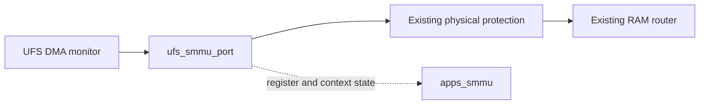

# Selected APPS and GPU SMMU composition

## Authority and result

Static analysis used the CPH2771 package selected by `build/private/sm8845-reconstructed.toml`.
ZIP members and decompressed PE images remained in memory. No extracted executable entered the repository.
The SM8845 runtime now uses the existing helper.
Its native run reaches the protection-policy failure after APDP.

| Selected image | SHA-256 |
| --- | --- |
| `IMAGES/xbl_sc.elf` | `a2011f59d74956ce3536c924ce9995dd0222b23492d713741b9397453540adc4` |
| `IMAGES/xbl_config.elf` | `2effcfac7784d044a34dbff04c0da063c17806083707af285952b75964d8376c` |
| `IMAGES/uefi.elf` | `13722b7ed849359e7afc731dfdc1eb0c1fc1815907d708f4b94cadb7e03be4f4` |
| UEFI PT_LOAD segment | `9de155cb1a9b0def15a486b5aef0c82e9a1eb9e3b4abc41bbb844dacc4d904e1` |
| HALIOMMU PE image | `2fbd28d8ae60326cf74eac44fd6081990724bbfa1db49045f179af0cf88848d1` |
| UFSDxe PE image | `6b872b8f86cbad939f6ecabaed7577246fd5946f85fcb0bc0b29ee4b09f87aeb` |

Reuse `platforms/qcom/sm88xx/sm8850/smmu.lua` directly. Its filename identifies its original evidence, not a different hardware model.
Do not add an SM8845 forwarding helper or duplicate its interrupt table.
The compatible is `arm,smmu-v2-v1`, implemented by `qcom_vp::ArmSmmuV2`.

## IORT decode

The configuration contains APPS IORT data in FDTs at file offsets `0x30c` and `0xf52c`.
Their sizes are `0xf220` and `0x2dc00` respectively.
The first APPS SMMU node matches every property in the selected SM8850 FDT at `0x2ac`.
The second differs only in its phandle, which is `0x75` instead of `2`.
Both UFS mappings reference their own APPS SMMU phandle.

| Property | Selected SM8845 value |
| --- | --- |
| SMMU path | `/soc/iort/APPS_MMU500_SMMU_APP` |
| BaseAddress | `0x15000000` |
| Span | `0x80000` |
| Model / Flags | `3` / `3` |
| Global GSIV / flags | `97` / `0` |
| Configuration GSIV / flags | `0` / `0` |
| Context count | `112`, not 128 |
| Context interrupt flags | All zero |
| PMU interrupt count | Zero |
| UFS path | `/soc/iort/NAMEDNODE_UFS_95MEM` |
| DevObjectName / address width | `UFS_MEM` / 36 |
| Mapping count / NumIDs | `1` / `1` |
| InputBase / OutputBase | `0x03030000` / `0x60` |
| Mapping flags | Zero |

All 112 context GSIV cells match the existing helper exactly, in order.
This includes the nonconsecutive values at indices 80 through 95.
The helper's 128 stream groups are a separate model capability, not the IORT context count.
The model does not claim captured silicon ID values.

## Selected XBL consumer

Addresses in this section are ELF virtual addresses.
The post-DDR callback list contains the SMMU initialization pointer at `0x148eb478`, targeting `0x14860450`.
The selected initialization loop reads ID0 and ID1 and initializes streams and contexts at `0x1486059c..0x14860664`.

| Helper | Access |
| --- | --- |
| `0x14860b44` | Read ID0 at base plus `0x20` |
| `0x14860b58` | Read ID1 at base plus `0x24` |
| `0x14860b18` | Write SMR at `0x800 + 4 * index` |
| `0x14860b04` | Write S2CR at `0xc00 + 4 * index` |
| `0x14860aa0` | Write CBAR at `0x1000 + 4 * index` |
| `0x14860aec` | Write CBA2R at `0x1800 + 4 * index` |
| `0x14860b80`, `0x14860b94` | Read/write NSCR0 at base plus `0x400` |
| `0x14860ba4` | Global invalidate `0x64`, sync `0x70`, poll `0x74` |

The stream loop writes invalid SMRs and S2CR type 2, which faults rather than bypasses.
The context loop writes CBAR type 2 and clears CBA2R.
At `0x14860668..0x1486069c`, XBL writes `(old & 0xffdff8c8) | 0x00200227` to NSCR0.
This leaves CLIENTPD set and USFCFG clear. It does not enable translated UFS DMA.

The context-fault helper at `0x14860be0` reads ID1 to calculate context placement.
It selects a 12-bit page shift when ID1.PAGESIZE is clear and 16 otherwise.
It adds `2 << ID1.NUMPAGENDXB` pages before the context index.
The existing model exposes ID1 `0x60000070`: 4 KiB pages, 112 contexts, and a context base at `+0x80000`.
Context 111 starts at `+0xef000`. The model's total aperture is therefore `0x100000`, not the IORT Span alone.
These are compatible virtual geometry values, not recovered physical ID1 contents.

## Selected UEFI consumer

All addresses in this section are PE RVAs.
The selected HALIOMMU and UFSDxe differ from the selected SM8850 binaries.
The following coordinates come from the SM8845 images, not an assumed relocation of SM8850 evidence.

UFSDxe `0x1c848` initializes its IOMMU path.
At `0x1c880..0x1c8a8`, mode 2 triggers property resolution for `EnableUfsIOC`, whose string is at `0x21577`.
The default mode word at `0x23cb8` is 2. A resolved mode must not be copied from another execution.
At `0x1c8ac..0x1c8b8`, the caller creates a domain through interface offset zero.
At `0x1c924..0x1c934`, it configures the domain through interface offset `0x40`.
At `0x1c96c..0x1c988`, it attaches `UFS_MEM`, with both remaining selectors zero.
The `UFS_MEM` string is at `0x21ab2`.

The HALIOMMU method table at `0xb0d0` selects configuration method `0x20f0` through offset `0x40`.
That method accepts modes 0 and 1, clears TTBR/MAIR state, and selects SCTLR `0xe0` or `0x0a9f00e0`.
Both values leave SCTLR.M clear. It calls domain update at `0x202c`.

| HALIOMMU helper | Register operation |
| --- | --- |
| `0x22f0` | SCTLR |
| `0x2540`, `0x25a8` | TTBR0, TTBR1 |
| `0x2270`, `0x22b0` | MAIR0, MAIR1 |
| `0x2610`, `0x2650` | TCR, TCR2 |
| `0x23a0`, `0x238c` | SMR, S2CR |
| `0x23f4` | Context invalidate `0x618`, sync `0x7f0`, poll `0x7f4` |

The context programming calls are at `0x1a9c..0x1b0c`.
The valid stream attachment writes are at `0x1bbc..0x1be0`.
The SCTLR helper independently decodes ID1 with the same context-base formula as XBL.

XBL explicitly uses the non-secure global bank at `+0x400`.
The selected UEFI sequence programs the ordinary stream/context offsets listed above.
It does not require a separate secure context snapshot or a second memory route.
Non-secure accesses and accesses at `+0x400` reach the non-secure global bank in the model.
Secure accesses below `+0x400` reach the secure bank.
Each bank controls the transactions of its own Security state.
The selected UEFI path uses Non-secure accesses and the `+0x400` alias.
This evidence does not prove complete secure-bank isolation or a completed UEFI execution.
No selected consumer above requires a new model version or broader ready/identity behavior.
Unsupported modes remain errors under the existing model contract.

## Integration and verification

`src/platform.cc` includes `smmu/smmu.h` and registers `qcom_vp::ArmSmmuV2` as `arm,smmu-v2-v1`.
Do not add another registration.
After the existing UFS DMA monitor and physical protection objects exist, call this helper once in the SM8845 runtime:

```lua
dofile(directory..'sm8850-smmu.lua')(platform, {
    router='apss_router',
    irq_bind=function(gsiv) return '&apss_gic.spi_in_'..(gsiv-32) end,
})
```

The helper requires the existing `ufs_dma_access -> ufs_dma_protection` physical binding.
It creates one `apps_smmu` owner and one `ufs_smmu_port` with StreamID `0x60`.
It binds the monitor's output to the port target and the port initiator to the existing physical protection.
The resulting path is:



The port initiator carries translated data and page walks. No RAM, LUN, controller, or protection backing is replaced.
Global GSIV 97 binds SPI input 65. Each context GSIV retains its table index and uses `GSIV - 32`.
The aperture is `[0x15000000, 0x15100000)` on the APSS MMIO router.
The helper rejects existing MMIO targets that overlap either SMMU aperture.
A composition check found exactly one mapped target in this aperture.
The check also confirmed 112 context IRQs, global SPI input 65, and the unchanged physical route.

The last recorded composition check passed before the Security partition change.
Rerun the integrated checks after this change. This document does not claim a pass.
SM8845 run21 preserves the original authenticated image loads through APDP.
Neither observation proves firmware-owned translation, completed UEFI storage, or Linux execution.

## GPU configuration group

The two selected OEM configurations contain `/soc/iort/GPU_GFX_MMU500_SMMU_GFX`.
The following results come from an in-memory FDT decode of `IMAGES/xbl_config.elf`.
No firmware executable was extracted or changed.

| OEM | Configuration SHA-256 | FDT file offsets | GPU phandles |
| --- | --- | --- | --- |
| SM8850 | `c35a368853ba57f00c9486d4b8fadeb0ded3a59ce410818a69ac415e3c44d3ef` | `0x2ac`, `0x10e14` | `3`, `123` |
| SM8845 | `2effcfac7784d044a34dbff04c0da063c17806083707af285952b75964d8376c` | `0x30c`, `0xf52c` | `3`, `118` |

All four GPU nodes have these values:

| Property | Value |
| --- | --- |
| BaseAddress / Span | `0x03da0000` / `0x20000` |
| Type / Revision / Model / Flags | `3` / `1` / `3` / `3` |
| Global GSIV / flags | `706` / `0` |
| Configuration GSIV / flags | `0` / `0` |
| Context interrupt count | `25` |
| Context interrupt flags | All zero |
| PMU interrupt count | Zero |

The ordered context GSIVs are:

```text
710 711 712 713 714 715 716 717 718 719 720 454 508
606 607 608 609 692 694 697 698 699 701 702 732
```

`NAMEDNODE_GPU` identifies `GPU`, with address width 36 and seven mappings.
Their output IDs are `0, 1, 2, 3, 4, 5, 7`.
Each mapping references its own GPU phandle.
These mappings describe firmware inputs. They do not authorize a fabricated DMA producer.

The shared helper now creates both instances for both runtime compositions.
The GPU uses ID1 `0x40000019`: 25 contexts, 4 KiB pages, and context base `+0x20000`.
Context 24 starts at `+0x38000`. The GPU aperture is `[0x03da0000, 0x03de0000)`.
The APPS aperture remains `[0x15000000, 0x15100000)`.
These apertures do not overlap each other.
The ID values describe the virtual implementation, not recovered silicon identity.
Both instances retain 128 stream entries, real context registers, fault state, and synchronous invalidation.
The GPU has no DMA or physical binding. It does not produce GPU traffic.
The UFS route and stream ID `0x60` remain unchanged.
The helper checks existing targets on the selected MMIO router before it changes the UFS route.
Nearby GFX CPR registers occupy `[0x03d9a000, 0x03d9e000)`, below the GPU aperture.

The existing native fixture now includes an unbound GPU configuration instance.
Its added checks cover advertised geometry, context 24, and rejected context 25 across the context register arrays.
The last active context also completes its invalidation request.
No new GPU DMA source exists in the fixture.
The last recorded check for this composition passed before the Security partition change.
Rerun the integrated checks after this change. This document does not claim a pass.
SM8850 run114 and SM8845 run100 complete `sbl1_smmu_init`, `boot_smem_init`, and `boot_ddr_share_data_to_aop`.
Both then stop at SHRM request `0x05030000`.
These runs do not establish PIMEM completion, UEFI execution, or kernel handoff.

### Native probes

For SM8850, capture ID0 at `0x14862534` and ID1 at `0x14862548`.
For SM8845, capture ID0 at `0x14860b44` and ID1 at `0x14860b58`.
Record the selected base with each value.
Expect GPU ID1 `0x40000019` and APPS ID1 `0x60000070`.
Capture the last stream and context writes, then NSCR0 and synchronization status.
For GPU, check SMR 127, S2CR 127, CBAR 24, and CBA2R 24.
Confirm that firmware reaches the next callback without an MMIO fault.
These are proposed probes, not runtime success claims.

